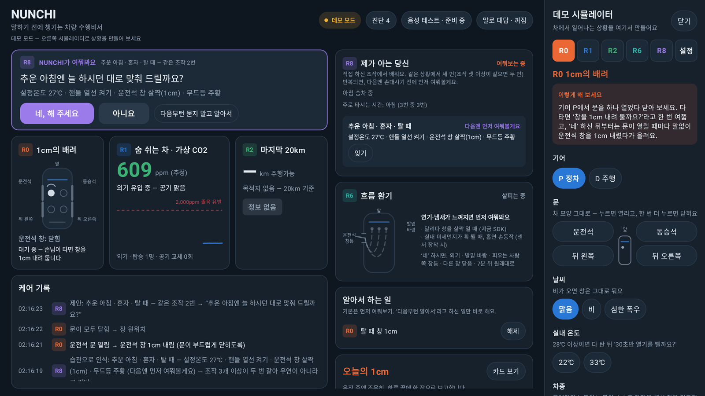
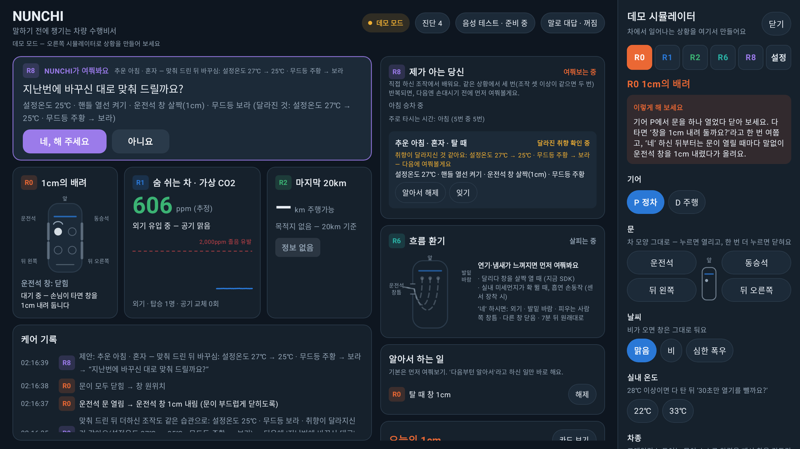
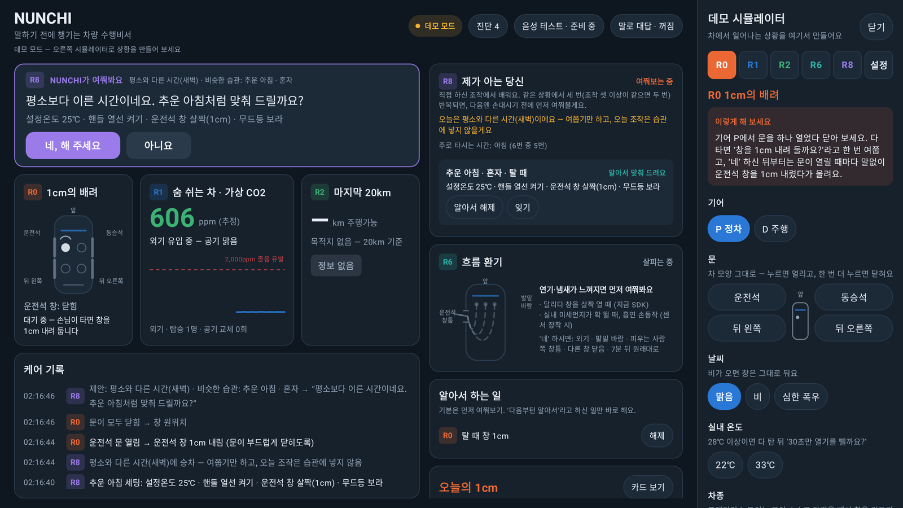

# NUNCHI(눈치) — 말하기 전에 챙기는 차량 수행비서

Pleos Connect 차량용 앱 MVP입니다. 일류 수행비서가 알아서 하는 일을 차량 신호와 기능으로 옮겼습니다.

| | |
|---|---|
| **한 줄 소개** | 차의 신호로 상황을 읽어 먼저 여쭙고, 사람의 손길에서 습관을 배워 말하기 전에 창·공조·시트·조명을 챙기는 차량 수행비서 |
| **APK** | [Releases](../../releases)의 `…_NUNCHI_release.apk` (release 빌드, 0.5.4) — 약 39MB로 GitHub 웹 업로드 한도(25MB)를 넘어 `apk/` 폴더 대신 Releases에 올렸습니다(`apk/README.md` 참고) |
| **실행 방법** | 아래 [Windows에서 실행하기](#windows에서-실행하기) — 에뮬레이터에 APK를 끌어다 놓으면 됩니다 |
| **테스트 환경** | Pleos Connect 에뮬레이터 **v2.1.0** (Android 14 · API 34 시스템 이미지, Automotive AVD) · 화면 **2560×1440 px 가로형**(xhdpi, 1280×720dp) · Windows · Android Studio |
| **필요한 설정** | 따로 없음(로그인·네트워크 불필요). '말로 대답'을 쓸 때만 에뮬레이터 Extended controls → Microphone에서 PC 마이크 허용 |

## 개입 원칙 — 먼저 여쭙고, 좋다고 하면 한다
- 찾아서 누르는 메뉴는 없습니다. NUNCHI가 상황을 보고 **먼저 제안**하고, 사용자는 **네 / 아니요**로 답합니다('괜찮아요'는 좋다·됐다 둘 다로 읽혀 쓰지 않음).
- 1분 안에 답이 없으면 조용히 거둡니다(재촉하지 않음). 같은 일을 두 번 연달아 사양하면 그날은 먼저 권하지 않습니다.
- 제안 화면의 **"다음부턴 묻지 말고 알아서"**를 누른 일만 바로 하고 짧게 알립니다. '알아서 하는 일' 카드에서 언제든 해제할 수 있습니다.
- 바꾼 것은 반드시 원래대로 돌려놓고, 운전자가 직접 만진 것은 존중합니다.

| 루틴 | 수행비서라면 | 앱이 하는 일 |
|---|---|---|
| **R0 1cm의 배려** | 손님이 타는 순간 창을 1cm 내려 문이 부드럽게 닫히게 한다 | 순간이 짧아 그때그때 물을 수 없으므로, 첫 승차가 끝나면 "다음부터 손님 타실 때 창을 1cm 내려 둘까요?"라고 한 번 여쭙고 허락받은 뒤부터 말없이 한다(정차 중 문 열림 → 창 최소 단계 → 모든 문이 닫히면 1.5초 뒤 원위치). 실내 28℃ 이상이면 "30초만 열기를 뺄까요?" 비가 오거나(와이퍼) 프레임리스 도어 차종이면 창은 그대로 |
| **R1 숨 쉬는 차** | 창을 오래 닫고 달리면 조용히 공기를 바꾼다 | 가상 CO2 센서(질량 균형 모델, 한국도로공사 2026.7 실험으로 보정). 내기순환 중 추정 1,900ppm에 닿으면 "공기가 탁해지고 있어요. 한 번 바꿀까요?" → 네라고 하면 외기 90초 → 내기 복귀. 3명 이상이면 주행 2분 뒤 "외기로 둘까요?"(터널은 차의 '외부 공기 유입 방지 제어'가 맡으므로 NUNCHI는 비켜 준다) |
| **R2 마지막 20km** | 경고등 대신 계획을 보고한다 | 목적지 여유율 20% 미만이면 "에어컨을 잠시 쉬고 바람을 줄일까요?"(속도는 대신 줄이지 않고 경제속도를 권하기만), 0% 미만이면 충전 계획 안내. 목적지가 없으면 주행가능 20km·10km 기준. 타이어 저압 안내 |
| **R6 흐름 환기** | 연기가 손님 쪽으로 번지기 전에 바람길을 연다 | 신호가 확실할수록 강하게: **달리다 창을 손으로 살짝 엶**(지금 SDK로 감지) → 말없이 화면에만 제안 / **실내 미세먼지 급상승·흡연 손동작**(센서 장착 시, 데모는 가상 센서) → "바람길 열어 드릴까요?"('담배'라고 말하지 않음). 네라고 하면 외기 + **발밑** 바람(최대보다 2단 아래, 정차 중엔 1단 더) + **피우는 사람 쪽 창틈**(약 2cm, 에뮬레이터는 1단계) + **다른 창은 닫음** → 발밑에서 창틈까지 한 줄기 흐름(치환 환기). **흡연 중엔 다른 조건을 덮어씀**: 차의 터널 차단도 환기 한 번에 한 번은 다시 열고(또 닫으면 다투지 않고 맡김), 비가 와도 창틈을 가장 작게(실차 약 0.5cm) 열어 계속, 심한 폭우(와이퍼 연속 고속)일 때만 창은 닫고 외기·발밑 바람만. 비가 오면 '발밑+앞유리'(김 서림 방지). 7분 뒤 또는 끄면 바꾼 것만 원래대로 |
| **R8 배우는 눈치** | 모시는 분이 매일 하시는 일을 몇 번 지켜본 뒤 "늘 하시던 대로 할까요?" 하고 먼저 여쭙는다. 남다른 습관도 그대로 존중한다 | 정해 둔 규칙 없이 **운전자의 직접 조작**에서 배운다. 20초 안에 이어서 바꾼 실내 설정(설정온도·에어컨·오토·운전석 열선/통풍·핸들/미러/유리 열선·무드등·창)을 한 묶음으로, 그때의 상황(시간대·바깥 온도·비·동승자·탈 때/달리는 중)과 함께 기억. 같은 상황에서 3번(조작 셋 이상이 같으면 2번) 반복되면 다음 승차 때 "추운 아침엔 늘 하시던 대로 맞춰 드릴까요?" → 네 / 아니요 / 다음부턴 알아서. 맞춘 것을 **원래대로 되돌리면 '원치 않음'**(다시 여쭙기), **다른 값으로 바꾸면 '달라진 취향'**(다음 승차 때 "지난번에 바꾸신 대로 맞춰 드릴까요?" → 네면 습관을 바로 고침). **평소와 다른 날**(평일·주말을 나눠 드문 시간대에 탐)엔 자동으로 하던 일도 여쭙기만 하고, 그날 조작은 습관에 넣지 않음. 차가 앞유리로 돌린 바람을 **두 번 곧바로 되돌리면** "앞유리 쪽 바람이 불편하신 것 같아요. 다음부터는 김이 서리기 전에 습기를 미리 빼 둘까요?" → 비 오는 날 젖은 채 탔거나 여럿·내기순환이면 에어컨+외기로 먼저 말리고 바람은 발밑으로(차가 이미 김을 막는 중이면 그 바람은 그대로). NUNCHI 자신의 명령과 그 반향, 차의 터널 공기 차단, 오토 공조가 바꾼 바람, 시동 끔은 배우지 않음. 익힌 것은 '제가 아는 당신' 카드에서 확인하고 지움 |
| **오늘의 1cm** | 하루 끝에 조용히 보고한다 | 운전 중엔 말을 아끼고, 주행이 끝나면(D→P) 그날 챙긴 일을 카드 한 장으로 보여 준다 |

주행 제어(조향·제동·가속)는 하지 않습니다.

### R8 배우는 눈치 — 앱 화면 (데모 시뮬레이터)

| 같은 묶음을 두 번 지켜본 뒤 먼저 여쭘 | 맞춰 드린 값을 바꾸신 다음 날 — 달라진 취향 확인 | 평소와 다른 시간 — 여쭙기만, 습관에 넣지 않음 |
|---|---|---|
|  |  |  |

## 구조

```
core/  플랫폼 독립 케어 엔진(순수 Kotlin) + 자동 테스트 119개(가상 운전자 실험 포함)
       VehicleSignal(차가 알려 주는 것) → CareEngine(R0·R1·R2·R6·R8) → Offer(제안) → 네 → CareCommand(차에 부탁하는 것)
       HabitLearner(R8): 운전자의 직접 조작 → 묶음 × 상황 → 습관 · 불편해하시는 것 · 달라진 취향
app/   Pleos Connect 앱: 상시 케어 서비스(CareService) + Vehicle SDK 2.3.2·AAOS 표준 속성 어댑터
       + Pleos 음성(TextToSpeech SDK 3.3.1 온디바이스, 안 되면 안드로이드 기본 TTS)
       + 화면(Compose: 정차 중 대시보드 / 운전 중 단순 화면) + 데모 시뮬레이터
docs/  앱 화면(README용)
```

엔진은 SDK와 분리돼 있어 차 없이도 JVM 단위 테스트로 검증할 수 있고, Pleos 탑재 차종이 늘어나도 차종별 차이는 어댑터에서만 맞추면 됩니다.

사용하는 Pleos Vehicle SDK API:
- Door `registerDoorPosition`
- Window `checkWindowPositionCapabilities`, `setWindowPosition`, `registerWindowPosition` (운전석 + 나머지 창 3개)
- HVAC `setHvacRecirculation`, `setHvacFanSpeed`, `setHvacFanDirection`, `getHvacFanDirection`, `checkHvacFanDirectionCapabilities`, `setHvacAc`, `registerHvacRecirculationState`, `registerHvacTemperatureCurrent`
  - R8: `setHvacTemperature`, `setHvacAuto`, `setHvacDefroster`, `registerHvacAcState`, `registerHvacAutoState`, `registerHvacTemperature`, `registerHvacDefrosterState`
- Seat `registerSeatOccupancy` / R8: `setHvacSeatTemperature`, `setHvacSeatVentilation`, `registerHvacSeatTemperature`, `registerHvacSeatVentilation`
- SteeringWheel (R8) `setHvacSteeringWheelHeat`, `registerHvacSteeringWheelHeatState`
- SideMirror (R8) `checkHvacSideMirrorHeatCapabilities`, `setHvacSideMirrorHeat`, `registerHvacSideMirrorHeatState`
- Light (R8) `checkAmbientLightBrightnessColorCapabilities`, `setAmbientLightSwitch`, `setAmbientLightBrightnessColor`, `registerAmbientLightStateListener`, `registerAmbientLightBrightnessColorListener`
- Wiper `registerWiperState`
- Gear `registerGearSelection`
- Odometer `registerRangeRemainingListener`
- Tire `registerTirePressure`, `getLowTirePressure`

안드로이드 차량 OS 표준 속성: `RANGE_REMAINING`, `GEAR_SELECTION`, `ENV_OUTSIDE_TEMPERATURE`(R8 바깥 온도)

사용하는 Pleos TextToSpeech SDK: `TextToSpeech(context, Mode.ON_DEVICE)` → `initialize` → `addEventListener` → `setLocale` → `speak` (권한 `pleos.car.permission.TTS_SERVICE`)

사용하는 Pleos SpeechToText SDK(실험, 말로 대답): `SpeechToText(context, Mode.ON_DEVICE)` → `initialize` → `addListener` → `setLocale` → `request` / `stop` (권한 `pleos.car.permission.STT_SERVICE`)

## Windows에서 실행하기

### 1) Pleos 에뮬레이터 설치 (한 번만)
1. Android Studio 웰컴 화면에서 **More Actions → SDK Manager**를 엽니다.
2. **SDK Update Sites** 탭에서 **+**를 누르고 아래처럼 입력한 뒤 OK.
   - Name: `Pleos Connect System Image`
   - URL: `https://nexus-playground.pleos.ai/repository/raw-releases/connect-avd/2.x/crp-sys-img.xml`
3. **SDK Platforms** 탭에서 **Show Package Details**를 체크합니다. Android 14(API 34)의 Pleos Connect 시스템 이미지를 체크하고 OK. 설치가 끝나면 Android Studio를 재시작합니다.
4. **More Actions → Virtual Device Manager → +**
   - Form Factor는 **Automotive**, 기기는 **Pleos Connect v2.1.0**을 고르고 Next.
   - Advanced Settings에서 Default boot는 **Cold**, RAM은 **4 GB**로 둡니다.
   - Device 탭으로 돌아와 **API 34 → Pleos Connect v2.1.0 APIs**를 고르고 Finish.

### 2) 앱 실행
- **방법 A — APK 바로 설치:** 이 저장소의 [Releases](../../releases)(오른쪽)에서 `…_NUNCHI_release.apk`를 내려받아, 에뮬레이터를 켠 뒤 에뮬레이터 창에 끌어다 놓습니다.
- **방법 B — 소스 빌드:** Android Studio에서 **Open → nunchi 폴더**를 엽니다. 처음 Gradle 동기화는 5~10분 걸립니다. 위쪽 기기 목록에서 Pleos AVD를 고르고 ▶ **Run 'app'**을 누릅니다. release APK는 `gradlew :app:assembleRelease`로 만들며 `app/build/outputs/apk/release/`에 생깁니다(비밀 키 없이 빌드되도록 디버그 키로 서명).

### 3) Virtual Console (선택)
명령 프롬프트(cmd)에서 아래 명령을 실행한 뒤, 브라우저로 `http://127.0.0.1:8088/`에 접속합니다.

```
"%LOCALAPPDATA%\Android\Sdk\platform-tools\adb.exe" forward tcp:8088 tcp:8088
```

문·창문·공조·기어·주행가능거리를 바꾸면 앱이 실제 차량 신호로 받아 반응합니다. 화면 오른쪽의 **시뮬레이터** 서랍으로도 같은 상황을 만들 수 있습니다.

## 시연 순서 (약 3분)
화면 오른쪽 **시뮬레이터** 서랍의 탭(**R0 · R1 · R2 · R6 · R8 · 설정**)을 고르면 그 장면에 필요한 버튼과 "이렇게 해 보세요" 순서가 나옵니다. 차 그림과 문·창 버튼은 모두 **앞이 위**(왼쪽 위가 운전석)입니다.

1. **R0 탭:** 기어 **P** → 문 **뒤 오른쪽** 열기 → 닫기 → "다음부터 손님 타실 때 창을 1cm 내려 둘까요?" → **네**. 다시 문을 열면 이제 말없이 운전석 창이 열리고(그림에 틈 표시), 닫으면 1.5초 뒤 원위치.
2. **R1 탭:** 탑승 **2명** → **내기순환** → **D 주행** → 빨리 감기 **×30**. CO2가 1,900ppm에 닿으면 "공기가 탁해지고 있어요. 한 번 바꿀까요?" → **네** → 외기 90초 뒤 내기 복귀. 여쭙는 동안은 빨리 감기가 멈춰 대답할 시간이 그대로 있습니다. **다음부턴 묻지 말고 알아서**를 누르면 그다음부터는 "공기 한 번 바꿀게요" 하고 바로 합니다.
3. **R6 탭:** **D 주행** → **동승석 흡연 손동작** → "바람길 열어 드릴까요?" → **네** → 외기·발밑 바람·동승석 창틈·다른 창 닫힘. **끄기**를 누르면 바꾼 것만 원래대로. (달리다 **창 → 운전석 1cm**를 누르면 말없이 화면에만 권합니다)
4. **R2 탭:** 목적지 **100km** → 주행가능거리를 **+10/−10**으로 120 → 110(빠듯: "에어컨을 잠시 쉴까요?") → 90(부족: 충전 안내). 여유가 돌아오면 쉬게 했던 에어컨·바람을 원래대로 돌려놓습니다.
5. **R8 탭 — 배우는 눈치:** **시각 아침 8시 · 바깥 영하 2℃** → **타기 → 독특한 조합 → 내리기**를 두 번 → 다시 **타기**: 문이 닫히자 "추운 아침엔 늘 하시던 대로 맞춰 드릴까요?" → **다음부턴 묻지 말고 알아서**. **내리기 → 타기**: 이제 말없이 맞추고 "추운 아침 세팅으로 맞춰 둘게요." 이때 **25℃**·**무드등 보라**를 누르면(원래 값으로 되돌린 게 아니라 바꿈) → **내리기 → 타기**: "지난번에 바꾸신 대로 맞춰 드릴까요?" → **네**(습관이 25℃·보라로 바뀜). 끝으로 **시각 새벽 4시 → 타기**: "평소보다 이른 시간이네요. 추운 아침처럼 맞춰 드릴까요?"(자동으로 하던 일도 여쭙기만). 화면의 **'제가 아는 당신'** 카드에 익힌 것과 상태가 쉬운 말로 보입니다. 유리 바람은 **차가: 바람을 앞유리로 → 운전자가 곧바로 되돌림**을 두 번 → "앞유리 쪽 바람이 불편하신 것 같아요. 다음부터는 김이 서리기 전에 습기를 미리 빼 둘까요?"
6. **마무리:** 달리다 기어 **P** → '오늘의 1cm' 카드가 자동으로 뜹니다.

처음부터 다시 하려면 **설정 탭 → 배운 것 모두 지우기 / 오늘 기록 초기화**(두 번 눌러 확인).

시뮬레이터의 **가상 센서**(흡연 손동작·실내 미세먼지)는 지금 Pleos SDK에 읽는 API가 없는 센서를 흉내 냅니다. 센서가 열리면 어댑터만 바꾸면 됩니다.

## 알려진 제약
- **창문 단계:** 에뮬레이터의 창문 위치 범위는 0~10이라, 1단계가 실제 1cm보다 큽니다(약 10%). 앱은 capability로 받은 최소 개방 단계를 씁니다.
- **SET 반영:** 에뮬레이터는 SET 이후 값이 바로 반영되지 않을 수 있습니다(공식 샘플 README에도 같은 내용이 있음). 그래서 엔진은 보낸 명령을 일단 반영해 두고, 실제 값이 오면 그 값으로 덮어씁니다.
- **차의 터널 차단과 함께 살기:** 현대·기아의 '외부 공기 유입 방지 제어'(사양 적용 시)는 내비 지도와 속도로 터널 약 7초 전에 열린 창을 닫고 내기로 바꾸며, 지나면 창을 원래 위치로 엽니다. NUNCHI는 이걸 따라 하지 않고, 사람의 조작으로 오해하지 않게 알아봅니다(달리는 중 '내기 켜짐 + 창 닫힘'이 3초 안에 함께 오면 차의 차단). 우선순위: **흡연이 아니면 차를 따르고**(외기 제안 안 함, 다시 열린 창을 '살짝 엶'으로 보지 않음), **흡연 환기 중이면 연기가 먼저**(한 번은 창·외기를 되돌리고, 차가 또 닫으면 맡겼다가 터널을 나오면 이어 감, 맡긴 채 끝나면 터널 규칙대로 내기·창 다시 열기는 나온 뒤). 길안내 중이면 NaviHelper의 '터널' 안내(TBT)로 미리 알 수 있어 다음 단계에서 붙입니다.
- **비 세기:** 우적센서 값 자체는 SDK·표준 속성에 없고, 와이퍼 켜짐/꺼짐과 스위치 위치(안개·간헐 1~5·연속 1~5·AUTO)만 읽힙니다. 비가 오는지는 와이퍼로 알 수 있지만(AUTO면 우적센서가 켠 것), 심한 폭우는 운전자가 연속 고속(2단 이상)으로 둘 때만 확실합니다. AUTO에선 세기를 몰라 보통 비로 봅니다.
- **차속:** Pleos Vehicle SDK엔 차속이 없지만, 안드로이드 차량 OS 표준 속성 `PERF_VEHICLE_SPEED`(CAR_SPEED 권한)로 읽을 수 있습니다. 정체 구간 판단 등에 다음 단계에서 씁니다.
- **운전 중 화면:** 주행 중엔 안드로이드 차량 OS가 앱 화면을 제한합니다. 앱은 운전 중 단순 화면(버튼은 NUNCHI가 여쭐 때의 네/아니요, 흐름 환기 중의 끄기뿐)을 갖추고 `distractionOptimized`를 선언했습니다. 차가 이를 받아들이지 않으면 '주행 중에는 사용할 수 없습니다' 화면이 뜹니다. 어느 쪽이든 판단·개입은 상시 서비스에서 계속 동작합니다.
- **음성:** Pleos TextToSpeech SDK 온디바이스 모드를 먼저 쓰고(승인·네트워크 불필요), 안 되면 안드로이드 기본 TTS, 그것도 없으면 화면에만 표시합니다. 위쪽 **음성 테스트** 버튼으로 바로 확인할 수 있고, **진단**에 엔진 준비·재생 시작/완료·오류가 남습니다. '재생 완료'까지 찍히는데 소리가 안 나면 앱이 아니라 에뮬레이터 볼륨·PC 소리 출력 문제입니다.
- **바람 방향:** SDK에 바람 방향 변경 알림(리스너)이 없어서, 앱 시작 때·운전자가 공조를 만질 때·환기를 켜기 직전에 읽어 원래 방향을 기억합니다.
- **냄새·흡연 감지:** Vehicle SDK 2.3.2엔 실내 공기질 수치나 카메라 API가 없습니다(공기청정·오토 내외기는 켜짐/꺼짐만). 그래서 지금은 '달리다 창을 살짝 여는 행동'을 약한 신호로 쓰고, 실내 미세먼지·흡연 손동작은 가상 센서로 시연합니다.
- **대답:** 기본은 화면 버튼(네/아니요)입니다. 위쪽 **말로 대답**을 켜면(실험) Pleos 음성 인식(SpeechToText 3.3.1 온디바이스, 권한 `pleos.car.permission.STT_SERVICE`)으로 여쭌 말이 끝난 뒤 6초 동안 한 번 듣고 "네·응·좋아" = 네, "아니요·됐어·그만" = 아니요, "알아서" = 다음부턴 알아서로 처리합니다. '괜찮아요'처럼 뜻이 갈리는 말은 대답으로 보지 않습니다. 에뮬레이터에선 Extended controls → Microphone에서 PC 마이크 입력을 허용해야 하고, 음성 인식 서비스가 없으면 '사용 불가'로 표시하고 화면 버튼만 씁니다. Gleo 연동(App Schema) 땐 Gleo로 넘깁니다.
- **R8 실내 설정:** 차종·에뮬레이터마다 열선·통풍·미러 열선·무드등 지원이 다릅니다. 앱은 지원 여부를 먼저 확인하고, 없는 기능은 진단에 한 번만 남기고 넘어갑니다. Virtual Console에 없는 설정은 데모 시뮬레이터의 '직접 조작'으로 시연합니다.
- **R8 바깥 온도·시각:** 바깥 온도는 표준 속성 `ENV_OUTSIDE_TEMPERATURE`(권한 `CAR_EXTERIOR_ENVIRONMENT`)로 읽고, 못 읽으면 탈 때의 실내 온도로 날씨를 가늠합니다. 습관의 시간대는 기기 시각으로 보며, 시연에선 시뮬레이터 '시각'으로 바꿉니다. '평소와 다른 날'은 같은 요일 종류(평일/주말)로 5번 이상 타 본 뒤부터 따집니다.
- **R8 저장:** 배운 것은 앱 저장소에 한 줄 형식으로 저장하며 차 밖으로 보내지 않습니다. 운전자 구분(Pleos ID)은 다음 단계입니다.
- **저사양 PC:** 그래픽 가속이 안 되는 PC에선 에뮬레이터가 화면을 CPU로 그려 음성이 끊기고 터치가 느릴 수 있습니다. 앱은 말하는 동안 화면 갱신을 쉬고, 환기 그림은 켜져 있을 때만 초당 8번 움직입니다. 에뮬레이터 볼륨이 작으면 에뮬레이터 옆 볼륨 버튼으로 올립니다.

## 다음 단계
- NaviHelper로 목적지까지 남은 거리 자동 연동(R2)
- Gleo App Schema 연동: 제안에 "네/아니요"로 대답, "공기 바꿔 줘", "오늘 뭐 챙겼어?"
- R6 효과를 미세먼지 측정기로 수치 검증(발밑 바람 vs 얼굴 바람)
- R3 지각 모드, R4 퇴근 후 10분, R9 골든타임 케어
- R8+: Pleos ID 연동으로 운전자마다 습관 따로, 달리는 중·경로 습관(퇴근길 마트 경유)

## 테스트

```
gradlew :core:test
```

CO2 모델 보정(2인 30분 5,000ppm), R0·R1·R2·R6·R8 동작, 그리고 '먼저 여쭙고 좋다고 하면 한다' 흐름(1분 뒤 조용히 거둠, 두 번 사양하면 그날은 조용히, "다음부턴 알아서" 허락, 상황이 바뀌면 제안 철회, 제안은 한 번에 하나)을 검증합니다. 예를 들어 2인이 45분 동안 내기순환으로 달려도 2,000ppm을 넘지 않는지, R6가 끝나면 운전자가 직접 만진 것만 빼고 원래대로 돌아오는지, R0가 창을 내려 둔 중에 환기를 켜도 끝나면 창이 닫힘으로 돌아오는지 확인합니다.

R8은 정해 둔 규칙 없이 직접 조작에서 배우는 만큼 '잘못 배우지 않는지'를 따로 검증합니다: 같은 묶음 3번이면 여쭙기, 조작 셋 이상이 두 번 같으면 바로 인식하기, 되돌림과 바꿈 구분(달라진 취향은 다음 승차 때 여쭙고 '네'면 습관을 고침), 평소와 다른 날엔 여쭙기만 하고 습관에 넣지 않기(그날 '아니요'는 습관에 반영 안 함), NUNCHI 자신의 명령 반향·차의 터널 공기 차단·오토 디포그 복귀·시동 끔(맞추자마자 곧바로 내려도)을 사람의 조작이나 '원치 않음'으로 오해하지 않기, 한 번 되돌렸던 값도 다시 맞추고 두면 '불편해하시는 것'에서 지우기, 저장 후 복원 등.

### 가상 운전자 실험 (R8)

```
gradlew :core:test -Psim=1 -Pseeds=20 --tests "*VirtualDriveExperiment*"
```

사람(가끔 잊고, 원치 않게 맞춰진 건 되돌리고, 10%는 대답 안 함)과 차(명령 반향, 오토 공조가 스스로 바꾸는 바람, 비 오는 날 오토 디포그)를 흉내 낸 가상 운전자 5명을 28일씩 돌려 `core/build/sim/report.md`에 결과를 씁니다. 기본값(20회 반복 평균):

| 가상 운전자 | 직접 조작 덜어 줌 | 처음 정확히 도운 승차 | 불필요한 제안 · 원치 않는 조정 |
|---|---|---|---|
| 독특한 조합(아침 27℃ + 창 1cm + 주황 무드등 + 미러 열선) | 94% | 4번째 | 0 · 0 |
| 출퇴근 운전자(평일 출퇴근 + 주말 가족 + 새벽 출장 하루) | 72% | 아침 5번째 · 저녁 6번째 | 새벽 출장에 묻지 않고 실행 0 · 학습 0 |
| 유리 바람을 꺼림(비 40%, 오토 디포그를 곧바로 되돌림) | 76% | 8번째 | 되돌림 2번에 습기 빼기 여쭘 → 4주간 약 10회 |
| 취향이 달라짐(셋째 주부터 열선·온도·무드등을 바꿈) | 79% | 달라진 뒤 2번째(알아차리기 끄면 5번째) | 달라진 뒤 덜어 줌 97%(끄면 61%) |
| 습관 없음(아무 때나·매번 다른 조작) | — | — | 4주에 0.1회 · 0 |
